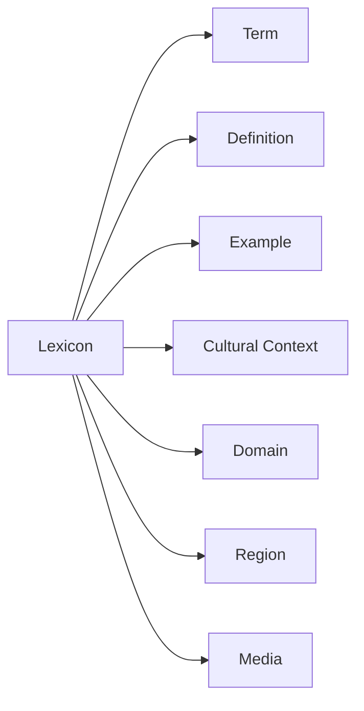

## 2.1 Brawijaya Corpora Project
*Brawijaya Corpora Project* merupakan sebuah projek Korpus digital yang menampung data literatur budaya Jawa Timur secara *multimodal*. Projek ini digarap oleh Fakultas Ilmu Budaya Universitas Brawijaya dengan dibantu tim rekayasa perangkat lunak dari Fakultas Ilmu Komputer Universitas Brawijaya (Yusron & Priyambadha, 2026). Proyek ini dibuat untuk membantu melestarikan kebudayaan lokal Jawa Timur dengan melakukan dokumentasi terstruktur terhadap aset aset literatur budaya. 

Berbeda dengan korpus linguistik konvensional yang umumnya hanya mengumpulkan teks tertulis, Brawijaya Corpora mengadopsi pendekatan korpus multimodal. Pendekatan ini mengintegrasikan data tekstual leksikon dengan artefak digital non-tekstual yang meliputi foto dokumentasi budaya, rekaman audio pelafalan oleh penutur asli, rekaman video, hingga rekonstruksi model tiga dimensi (3D). Selain itu, korpus ini memuat atribut koordinat geografis (*latitude* dan *longitude*) untuk mendukung pemetaan distribusi kebudayaan di wilayah Jawa Timur.

### 2.1.1 Struktur Data Leksikon
Pada penelitian ini, data yang digunakan dari Brawijaya Corpora adalah data leksikon tekstual. Hal ini dikarenakan penelitian ini berfokus pada sistem pencarian informasi berbasis teks. Secara konseptual, struktur data leksikon budaya direpresentasikan sebagai berikut:

Setiap elemen dalam struktur hierarkis data leksikon tersebut memiliki fungsi dan spesifikasi informasi sebagai berikut:
1. **`Term` (Istilah Leksikon)**: Ungkapan budaya atau istilah leksikon.
2. **`Definition` (Definisi Konseptual)**: Makna dari leksikon.
3. **`Example` (Contoh Penggunaan)**: Contoh penggunaan leksikon dalam sebuah kalimat.
4. **`Cultural Context` (Konteks Budaya dan Etimologi)**: Penjelasan mengenai asal-usul (*etymology*), latar belakang, serta nilai filosofis yang terkandung di dalam leksikon.
5. **`Domain` (Domain Kodifikasi Budaya)**: Menunjukkan kategori ranah budaya berdasarkan taksonomi *Codification Domain System* yang dibuat pada Brawijaya Corpora Project(Yusron & Priyambadha, 2026).
6. **`Region` (Entitas Budaya dan Geografis)**: Asal daerah/subkultur dari leksikon.
7. **`Media` (Aset Multimodal)**: Aset multimodel leksikon seperti foto, video, audio, atau objek 3D.

Dalam basis data yang digunakan Brawijaya Corpora Project, struktur ini direalisasikan ke dalam skema *Third Normal Form* (3NF) berbasis PostgreSQL. Entitas utama `LEXICON` berelasi langsung dengan tabel `CODIFICATION_DOMAIN`, `SUBCULTURE`, dan `CULTURE`, serta terhubung dengan tabel `ASSET` (multimedia), `REFERENCE` (sumber rujukan ilmiah), dan `CONTRIBUTOR` (pengumpul data) melalui tabel-tabel perantara (*junction tables*).

### 2.1.2 Sistem Pencarian Brawijaya Corpora Project
Sistem backend Brawijaya Corpora saat ini mengimplementasikan mekanisme pencarian berbasis kata kunci (*keyword-based search*) melalui fitur *full-text search* pada lapisan basis data relasional PostgreSQL (Yusron & Priyambadha, 2026). Pencarian ini diintegrasikan dengan fitur *advanced filtering* berdasarkan beberapa parameter, seperti domain kodifikasi, subkultur, dan dan status publikasi dokumen. Saat ini, istem pencarian berbasis kata kunci mampu bekerja dengan cepat untuk pencarian kata yang sederhana.

Meskipun demikian, pengguna repositori Brawijaya Corpora memiliki latar belakang yang sangat beragam, sehingga memungkinkan beberapa jenis karakteristik kueri yang berbeda. Sebagai contoh, kueri yang dimasukan oleh orang yang memiliki literasi budaya tinggi pada budaya Jawa Timur akan berbeda dengan kueri yang dimasukan oleh orang yang lebih awam. Pengguna yang memiliki literasi budaya tinggi akan memasukkan kueri eksak berupa leksikon atau istilah budaya Jawa Timur, sedangkan pengguna yang lebih awam akan memasukkan kueri deskriptif yang lebih bersifat konseptual. Hal ini dapat menyebabkan munculnya *vocabulary mismatch* yang dapat mengganggu pengalaman pengguna dalam menggunakan sistem pencarian. 

Ketergantungan pada pencocokan leksikal eksak menyebabkan sistem gagal menemukan leksikon yang relevan saat pengguna memasukkan kueri konseptual deskriptif yang tidak tertulis secara harfiah pada atribut leksikon. Keterbatasan ini melandasi pentingnya studi komparatif antara pendekatan *keyword-based search*, *semantic search* (*dense retrieval*), dan *hybrid search* untuk menentukan metode *information retrieval* yang paling optimal untuk Brawijaya Corpora.