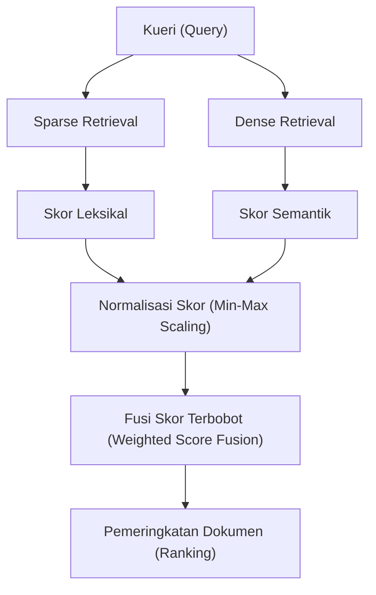

## 2.6 Hybrid Retrieval

*Hybrid retrieval* merupakan pendekatan dalam *information retrieval* yang menggabungkan dua atau lebih metode penelusuran untuk menyatukan keunggulan masing-masing metode (Bruch et al., 2024). Pada penelitian ini, metode yang dipadukan adalah penelusuran berbasis kata kunci (*keyword-based/lexical retrieval*) dan penelusuran berbasis makna (*semantic-based retrieval*). Metode leksikal sangat akurat dalam mencocokkan kata kunci atau entitas yang sama persis, sementara metode semantik unggul dalam memahami kemiripan makna konseptual meskipun kueri mengalami kesenjangan istilah (*vocabulary mismatch*).

Berdasarkan diagram alir di atas, alur kerja sistem *hybrid retrieval* diawali saat kueri pengguna (*query*) diterima dan diproses secara paralel oleh dua jalur penelusuran, yaitu BM25 (*sparse*) dan BGE-M3 (*dense*). BM25 menghitung kecocokan kata kunci untuk menghasilkan skor leksikal, sementara BGE-M3 memetakan kueri dan dokumen ke dalam representasi semantik untuk menghasilkan skor semantik. Karena kedua model menghasilkan rentang nilai yang berbeda, skor leksikal dan skor semantik tersebut disetarakan terlebih dahulu menggunakan normalisasi Min-Max (*Min-Max Scaling*). Setelah memiliki skala yang seragam, kedua skor digabungkan melalui fusi skor terbobot (*weighted score fusion*). Pada tahap akhir, sistem melakukan pemeringkatan (*ranking*) dokumen berdasarkan skor gabungan tertinggi untuk menyajikan hasil pencarian yang paling relevan.

### 2.6.1 Normalisasi Skor

Normalisasi skor merupakan prosedur transformasi matematis yang memetakan skor relevansi dari model-model *information retrieval* yang berbeda ke dalam skala numerik standar sebelum proses penggabungan dilakukan (Posokhov et al., 2026). Langkah ini dilakukan agar skor yang dihasilkan model-model memiliki skala yang sama.

Pada arsitektur sistem yang diusulkan, BM25 dan BGE-M3 menghasilkan skor relevansi dengan karakteristik ruang numerik yang berbeda. Skor BM25 bersifat tidak terbatas, sedangkan skor BGE-M3 bersifat terbatas. Perbedaan skala tersebut memicu masalah dominasi skala (*scale dominance*), di mana penjumlahan skor mentah secara langsung (*raw score summation*) akan menyebabkan bias menuju skor BM25 yang bersifat tidak terbatas. Maka dari itu, normalisasi skor dibutuhkan agar sistem dapat menggabungkan skor dari kedua metode secara adil.

Dalam penelitian ini, metode yang digunakan untuk menyelaraskan skor relevansi adalah **Normalisasi Min-Max** (*Min-Max Normalization*). Normalisasi Min-Max memetakan skor perolehan masing-masing metode penelusuran secara linier ke dalam rentang tertutup $[0, 1]$ berdasarkan skor tertinggi dan terendah dari daftar dokumen kandidat yang terambil. Rumus normalisasi Min-Max didefinisikan sebagai berikut:

$$S' = \frac{S - S_{\min}}{S_{\max} - S_{\min}}$$

di mana:
- $S'$ menyatakan skor relevansi hasil normalisasi yang berada pada interval $[0, 1]$.
- $S$ menyatakan skor relevansi mentah (*raw score*) dokumen kandidat yang dihasilkan oleh model penelusuran (BM25 atau BGE-M3).
- $S_{\min}$ menyatakan nilai skor relevansi terendah di antara seluruh dokumen kandidat yang ditemukan untuk kueri yang bersangkutan.
- $S_{\max}$ menyatakan nilai skor relevansi tertinggi di antara seluruh dokumen kandidat yang ditemukan untuk kueri yang bersangkutan.

### 2.6.2 Fusi Skor Terbobot (*Weighted Score Fusion*)

Setelah skor dari BM25 dan BGE-M3 dinormalisasikan, kedua skor tersebut diintegrasikan menggunakan teknik *weighted score fusion*. Teknik ini menggabungkan nilai kecocokan leksikal dan kemiripan semantik menjadi satu kesatuan nilai akhir dengan menetapkan bobot kontribusi tertentu bagi masing-masing metode penelusuran (Bruch et al., 2024).

Formulasi perhitungan skor gabungan bagi dokumen $d$ terhadap kueri $q$ dirumuskan sebagai berikut:

$$S_{\text{hybrid}}(d, q) = \alpha \cdot S'_{\text{dense}}(d, q) + (1 - \alpha) \cdot S'_{\text{sparse}}(d, q)$$

di mana:
- $S_{\text{hybrid}}(d, q)$ menyatakan skor gabungan bagi dokumen $d$ terhadap kueri $q$.
- $S'_{\text{dense}}(d, q)$ menyatakan skor penelusuran semantik padat BGE-M3 yang telah dinormalisasi menggunakan Min-Max.
- $S'_{\text{sparse}}(d, q)$ menyatakan skor penelusuran leksikal BM25 yang telah dinormalisasi menggunakan Min-Max.
- $\alpha$ merupakan parameter koefisien pembobotan untuk penelusuran semantik BGE-M3 ($0 \le \alpha \le 1$).
- $(1 - \alpha)$ merupakan parameter koefisien pembobotan komplementer untuk penelusuran leksikal BM25.

Nilai $\alpha$ merupakan bobot yang akan menentukan bias sistem. Semakin tinggi $\alpha$, maka sistem akan semakin bias terhadap penelusuran semantik BGE-M3. Sebaliknya, semakin rendah $\alpha$, maka sistem akan semakin bias terhadap penelusuran leksikal BM25. Nilai ini merupakan parameter yang akan dioptimalkan pada penelitian ini untuk menentukan bobot terbaik melalui eksperimen pada *validation set*.