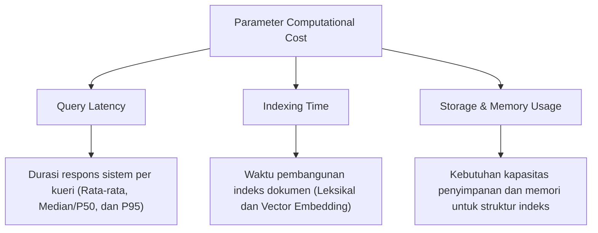

## 2.7 Evaluation of Information Retrieval

Evaluasi dilakukan untuk mengukur kemampuan suatu sistem *information retrieval* dalam menemukan dan mengurutkan dokumen yang relevan terhadap suatu kueri. Evaluasi diperlukan untuk mengetahui seberapa baik suatu metode *retrieval* dalam menghasilkan dokumen yang sesuai dengan kebutuhan pengguna. Dalam penelitian ini, evaluasi digunakan untuk membandingkan tiga metode *retrieval*, yaitu BM25 sebagai pendekatan *sparse retrieval*, BGE-M3 sebagai pendekatan *dense retrieval*, dan *hybrid retrieval* yang menggabungkan kedua pendekatan tersebut.

Evaluasi dilakukan berdasarkan dua aspek utama, yaitu **retrieval effectiveness** dan **computational cost**. *Retrieval effectiveness* digunakan untuk mengukur kualitas hasil pencarian berdasarkan relevansi dokumen yang dikembalikan terhadap kueri pengguna. Sementara itu, *computational cost* digunakan untuk mengukur sumber daya komputasi yang diperlukan oleh masing-masing metode dalam melakukan proses pencarian. Dengan mempertimbangkan kedua aspek tersebut, penelitian tidak hanya dapat menentukan metode yang menghasilkan kualitas pencarian terbaik, tetapi juga metode yang memberikan efisiensi komputasi yang sesuai untuk penerapan pada Brawijaya Corpora.

### 2.7.1 Precision@K

*Precision@K* merupakan metrik yang digunakan untuk mengukur proporsi dokumen relevan pada sejumlah \(K\) dokumen pertama yang dikembalikan oleh sistem. Metrik ini menunjukkan seberapa baik sistem dalam menghasilkan hasil pencarian yang relevan pada posisi teratas.

Precision@K dapat dirumuskan sebagai:

$$
Precision@K =
\frac{\text{Jumlah dokumen relevan pada }K\text{ hasil teratas}}
{K}
$$

Nilai Precision@K yang semakin tinggi menunjukkan bahwa semakin besar proporsi hasil pencarian pada posisi teratas yang relevan. Dalam penelitian ini, Precision@K digunakan untuk mengetahui kemampuan BM25, BGE-M3, dan *hybrid retrieval* dalam menghasilkan hasil pencarian yang relevan pada sejumlah dokumen teratas.

### 2.7.2 Recall@K

*Recall@K* merupakan metrik yang mengukur proporsi dokumen relevan yang berhasil ditemukan oleh sistem dari keseluruhan dokumen yang diketahui relevan terhadap suatu kueri. Berbeda dengan Precision@K yang berfokus pada ketepatan hasil yang dikembalikan, Recall@K berfokus pada kemampuan sistem dalam menemukan sebanyak mungkin dokumen yang relevan.

Recall@K dapat dirumuskan sebagai:

$$
Recall@K =
\frac{\text{Jumlah dokumen relevan yang ditemukan pada }K\text{ hasil}}
{\text{Jumlah seluruh dokumen relevan}}
$$

Nilai Recall@K yang semakin tinggi menunjukkan kemampuan sistem yang semakin baik dalam menemukan dokumen-dokumen yang relevan. Metrik ini penting dalam Brawijaya Corpora karena suatu kueri dapat memiliki beberapa dokumen yang relevan, sehingga sistem diharapkan tidak hanya menemukan satu hasil yang sesuai tetapi juga mampu menemukan informasi relevan lainnya.

### 2.7.3 Mean Reciprocal Rank (MRR)

*Mean Reciprocal Rank* (MRR) merupakan metrik evaluasi yang digunakan untuk mengukur seberapa tinggi posisi dokumen relevan pertama dalam hasil pencarian. MRR memberikan perhatian khusus terhadap posisi dokumen relevan pertama, sehingga semakin awal dokumen relevan ditemukan, semakin tinggi nilai yang diperoleh.

Untuk suatu kueri, *reciprocal rank* dihitung menggunakan:

$$
RR_i = \frac{1}{rank_i}
$$

dengan \(rank_i\) merupakan posisi dokumen relevan pertama pada hasil pencarian untuk kueri ke-\(i\). Nilai MRR kemudian dihitung sebagai rata-rata *reciprocal rank* dari seluruh kueri:

$$
MRR =
\frac{1}{|Q|}
\sum_{i=1}^{|Q|}
\frac{1}{rank_i}
$$

Dalam penelitian ini, MRR digunakan untuk membandingkan kemampuan BM25, BGE-M3, dan *hybrid retrieval* dalam menempatkan dokumen relevan pertama pada posisi yang tinggi dalam hasil pencarian.

### 2.7.4 Normalized Discounted Cumulative Gain (NDCG@K)

*Normalized Discounted Cumulative Gain* (NDCG@K) merupakan metrik yang digunakan untuk mengevaluasi kualitas suatu hasil pemeringkatan dengan mempertimbangkan **tingkat relevansi dokumen dan posisi dokumen dalam ranking**. Berbeda dengan metrik yang hanya membedakan dokumen relevan dan tidak relevan, NDCG dapat menggunakan *graded relevance*, sehingga setiap dokumen dapat diberikan tingkat relevansi yang berbeda.

*Discounted Cumulative Gain* (DCG) digunakan untuk menghitung nilai relevansi kumulatif dari dokumen yang dikembalikan dengan memberikan penalti terhadap dokumen relevan yang berada pada posisi lebih rendah. Salah satu formulasi DCG yang umum digunakan adalah:

$$
DCG@K =
\sum_{i=1}^{K}
\frac{2^{rel_i}-1}{\log_2(i+1)}
$$

dengan \(rel_i\) merupakan tingkat relevansi dokumen pada posisi ke-\(i\).

Persamaan tersebut menunjukkan bahwa dokumen yang memiliki relevansi tinggi akan memberikan kontribusi yang besar terhadap nilai DCG, sedangkan kontribusi tersebut akan berkurang apabila dokumen berada pada posisi yang semakin rendah.

Karena nilai DCG dipengaruhi oleh jumlah dokumen dan tingkat relevansinya, nilai tersebut perlu dinormalisasi agar dapat dibandingkan antar-kueri. Proses normalisasi dilakukan menggunakan *Ideal Discounted Cumulative Gain* (IDCG), yaitu nilai DCG yang diperoleh apabila seluruh dokumen pada hasil pencarian disusun dalam urutan ideal berdasarkan tingkat relevansinya.

NDCG@K kemudian dihitung sebagai:

$$
NDCG@K =
\frac{DCG@K}{IDCG@K}
$$

Nilai NDCG berada pada rentang 0 hingga 1. Nilai yang semakin mendekati 1 menunjukkan bahwa urutan dokumen yang dihasilkan sistem semakin mendekati urutan ideal.

### 2.7.5 Computational Cost

*Computational cost* merupakan aspek yang digunakan untuk mengukur sumber daya komputasi yang diperlukan oleh suatu metode *Information Retrieval*. Evaluasi terhadap biaya komputasi diperlukan karena metode dengan kualitas hasil pencarian yang lebih tinggi belum tentu menjadi metode yang paling sesuai untuk diterapkan apabila membutuhkan sumber daya yang jauh lebih besar.

Dalam penelitian ini, *computational cost* dievaluasi melalui tiga parameter utama yang diilustrasikan pada diagram alir berikut:

Berdasarkan ketiga parameter pada diagram alir di atas (*query latency*, *indexing time*, serta *storage & memory usage*), evaluasi *computational cost* memungkinkan penelitian untuk membandingkan efisiensi komputasi antara BM25, BGE-M3, dan *hybrid retrieval*. Pengukuran kecepatan respons sistem per kueri, waktu yang dihabiskan dalam pembangunan struktur indeks, serta konsumsi ruang penyimpanan dan memori menjadi dasar pertimbangan kelayakan implementasi. Dengan demikian, metode yang memiliki efektivitas pencarian (*retrieval effectiveness*) tinggi namun membutuhkan sumber daya besar dapat dibandingkan secara adil dengan metode yang membutuhkan biaya komputasi lebih rendah, sehingga pemilihan metode penelusuran untuk Brawijaya Corpora dapat mempertimbangkan keseimbangan optimal antara kualitas hasil temu balik dan efisiensi sumber daya komputasi.
