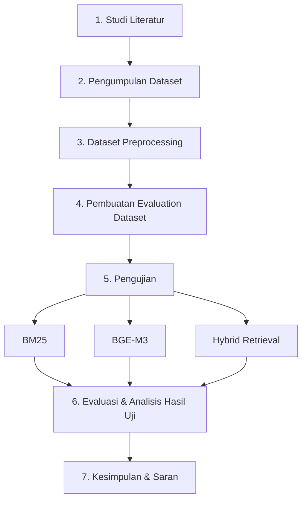
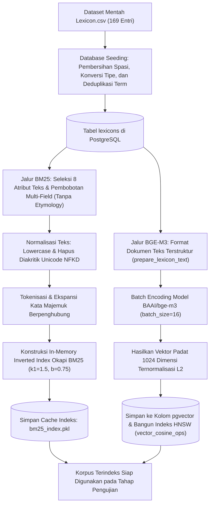
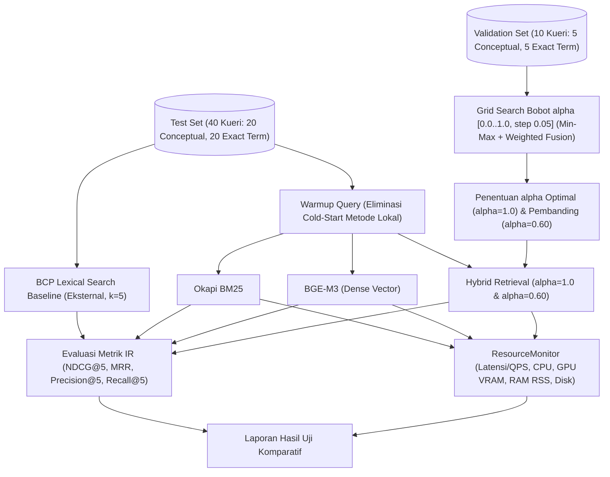

## 3.4 Tahapan Penelitian

Penelitian ini dilaksanakan melalui serangkaian tahapan sistematis untuk membandingkan performa *keyword-based retrieval*, *dense retrieval*, dan *hybrid retrieval*. Alur tahapan penelitian secara menyeluruh disajikan pada diagram alir (*flowchart*) berikut:

Secara garis besar, tahapan penelitian diawali dengan studi literatur untuk memperoleh landasan teori terkait algoritma dan teknologi *information retrieval*. Tahap kedua adalah pengumpulan dataset leksikon dari repositori Brawijaya Corpora Project. Data mentah tersebut selanjutnya diproses pada tahap *dataset preprocessing* melalui pembentukan teks dokumen, pembuatan indeks BM25, serta proses *document embedding* menggunakan BGE-M3. Tahap berikutnya adalah pembuatan dataset evaluasi yang mencakup penyusunan kueri uji beserta *ground truth* relevansi yang dipisahkan menjadi *validation set* dan *test set*. Pada tahap pengujian, dilakukan evaluasi pencarian terhadap metode BM25, BGE-M3, dan *hybrid retrieval*, termasuk optimasi parameter bobot $\alpha$ pada *validation set*. Hasil pengujian kemudian dievaluasi dan dianalisis menggunakan metrik *retrieval effectiveness* dan *computational cost*. Rangkaian penelitian diakhiri dengan penarikan kesimpulan dan pemberian saran.

Penjelasan ringkas untuk masing-masing tahapan diuraikan pada subbab-subbab berikut.

### 3.4.1 Studi Literatur

Studi literatur dilakukan dengan mempelajari teori, konsep dasar, dan penelitian terdahulu yang relevan dengan bidang *information retrieval*. Kajian difokuskan pada:
1. Pendekatan *keyword-based retrieval* menggunakan algoritma BM25 (*Best Matching 25*) serta pemahaman keterbatasan leksikal berupa *vocabulary mismatch*;
2. Pendekatan *dense semantic retrieval* berbasis representasi vektor kontinu, arsitektur model BAAI/bge-m3, dan perhitungan jarak kemiripan kosinus (*cosine similarity*);
3. Pendekatan *hybrid retrieval* yang menggabungkan skor leksikal dan semantik menggunakan fusi skor terbobot (*weighted score fusion*) serta fungsi normalisasi Min-Max;
4. Kerangka evaluasi baku sistem temu balik informasi untuk menilai kualitas hasil penelusuran (*retrieval effectiveness*) dan efisiensi beban komputasi (*computational cost*).

### 3.4.2 Pengumpulan Dataset

Dataset penelitian diperoleh dari data tekstual leksikon budaya pada repositori Brawijaya Corpora Project. Setiap entri leksikon diperlakukan sebagai satu dokumen yang dapat ditelusuri oleh sistem pencarian. Atribut-atribut tekstual yang dihimpun meliputi istilah (*term*), definisi (*definition*), contoh penggunaan dalam kalimat (*example*), serta konteks budaya atau etimologi (*cultural context / etymology*). Setiap dokumen diberi identitas unik (*unique identifier*) agar hasil penelusuran dari BM25, BGE-M3, maupun *hybrid retrieval* dapat dipetakan secara akurat terhadap leksikon yang bersangkutan serta digunakan dalam penyusunan *ground truth* evaluasi.

### 3.4.3 Dataset Preprocessing

Tahap *dataset preprocessing* bertujuan untuk menyiapkan data mentah korpus leksikon dari berkas `Lexicon.csv` (169 entri) agar dapat diindeks dan diproses oleh metode *sparse retrieval* (BM25) maupun *dense retrieval* (BGE-M3). Alur proses *dataset preprocessing* ditunjukkan pada diagram alir (*flowchart*) berikut:

Berdasarkan diagram alir di atas, proses diawali dengan *database seeding* untuk memuat 169 entri dari `Lexicon.csv` ke tabel `lexicons` di PostgreSQL disertai pembersihan spasi, konversi tipe data, dan deduplikasi `Term`. Dari basis data tersebut, korpus diproses melalui dua jalur paralel. Pada jalur *sparse retrieval* (BM25), delapan atribut teks berbobot *multi-field* (tanpa `etymology` untuk menghindari derau lintas bahasa) dinormalisasi menjadi huruf kecil tanpa diakritik (Unicode NFKD), ditokenisasi dengan ekspansi kata majemuk berpenghubung, lalu disusun menjadi *in-memory inverted index* Okapi BM25 ($k_1 = 1{,}5$, $b = 0{,}75$) dan disimpan ke `bm25_index.pkl`. Sementara itu, pada jalur *dense retrieval* (BGE-M3), atribut relevan tiap leksikon diformat menjadi dokumen teks terstruktur dan di-*encode* secara *batch* (`batch_size = 16`) menggunakan `BAAI/bge-m3` menjadi vektor padat 1024 dimensi ternormalisasi L2 yang disimpan pada kolom `pgvector` beserta indeks HNSW (`vector_cosine_ops`).

### 3.4.4 Pembuatan Dataset Evaluasi (*Evaluation Dataset*)

Dataset evaluasi (`Dataset/Evaluation/Evaluation.csv`) disusun sebagai tolok ukur objektif untuk menguji dan membandingkan performa temu balik setiap metode. Secara singkat, dataset ini terdiri atas **50 kueri uji unik** yang menghasilkan **158 pasangan penilaian relevansi kueri-dokumen** dengan 7 atribut kolom (`Query_id`, `Query_type`, `Query_text`, `Target_Term`, `Target_Term_Definition`, `Relavance_label`, dan `Rationale`). Penilaian relevansi menggunakan skala berjenjang (*graded relevance*), yakni label **2** untuk dokumen target utama yang sangat relevan (64 pasangan) dan label **1** untuk dokumen terkait yang relevan (94 pasangan).

Kueri pada dataset evaluasi dirancang ke dalam dua tipe utama, yaitu ***exact term query*** (25 kueri) dan ***conceptual query*** (25 kueri). Pembagian dua tipe kueri ini diperlukan untuk merepresentasikan keragaman pola pencarian pengguna karena target pengguna sistem Brawijaya Corpora Project (BCP) sangat luas—mulai dari peneliti atau budayawan yang sudah mengetahui istilah daerah secara spesifik hingga masyarakat umum maupun akademisi lintas disiplin yang melakukan pencarian berbasis deskripsi konsep atau bahasa Inggris tanpa mengetahui istilah lokalnya. Dataset evaluasi ini dibuat oleh penguji/penulis dengan mensimulasikan proses pencarian serta pembentukan kueri oleh pengguna sistem BCP, dan selanjutnya divalidasi oleh tim linguistik BCP untuk menjamin kesahihan makna budaya dan kebahasaan. Contoh sampel data dari `Evaluation.csv` disajikan pada Tabel 3.3.

Tabel 3.3 Contoh Data pada Dataset Evaluasi (`Evaluation.csv`)

| Query_id | Query_type | Query_text | Target_Term | Target_Term_Definition (Ringkas) | Relevance Label | Rationale |
| :---: | :--- | :--- | :--- | :--- | :---: | :--- |
| Q-001 | Conceptual | ritual for babies | Among-among | *An Among-among is Tengger's protection rite for 44-day-old babies...* | 2 | Sangat relevan (target utama) karena secara spesifik mendefinisikan ritus selamatan perlindungan bagi bayi berusia 44 hari di kalangan masyarakat Tengger. |
| Q-001 | Conceptual | ritual for babies | Tugel kuncung | *A traditional haircut ritual performed to mark a child’s transition from infancy to childhood...* | 1 | Memiliki relevansi karena merupakan ritus pemotongan ujung rambut (*kuncung*) untuk menandai peralihan anak dari masa bayi menuju kanak-kanak. |
| Q-001 | Conceptual | ritual for babies | Sayut | *A traditional pregnancy ritual performed in Tengger before childbirth to pray for safety...* | 1 | Terkait erat dalam rangkaian siklus kelahiran di Tengger karena merupakan upacara selamatan kehamilan menjelang kelahiran bayi. |
| Q-026 | Exact term | Cangkriman | Cangkriman | *A traditional riddle based on wordplay and poetic allegories, performed in Tengger Karo rituals...* | 2 | Target utama leksikon yang secara langsung mendefinisikan tradisi teka-teki puitis (*cangkriman*) yang dibawakan dukun adat setelah doa utama ritual Karo. |
| Q-026 | Exact term | Cangkriman | Kertijaya | *A ritual figure in cangkriman performed in Karo rituals who answers riddles posed by Ardijaya...* | 1 | Terkait erat karena merupakan figur ritual dalam pertunjukan *cangkriman* pada perayaan Karo yang bertugas menjawab teka-teki dari tokoh Ardijaya. |
| Q-026 | Exact term | Cangkriman | Sajeng | *A traditional fermented drink made from glutinous rice and shrimp paste used in Tengger rituals...* | 1 | Memiliki relevansi karena merupakan minuman fermentasi ketan dan terasi yang disajikan sebagai hukuman simbolis dalam permainan teka-teki *cangkriman*. |

Selanjutnya, dataset evaluasi dipecah secara terstratifikasi berdasarkan `Query_id` (`seed = 42`) menjadi dua himpunan terpisah dengan rasio **20:80**, sehingga proporsi tipe kueri *Conceptual* dan *Exact term* tetap seimbang pada kedua bagian. ***Validation set*** (**20%**, terdiri atas 10 kueri atau 30 pasangan relevansi: 5 *Conceptual* dan 5 *Exact term* pada `validation_set.csv`) digunakan khusus untuk melakukan penyetelan (*tuning*) parameter bobot $\alpha$ melalui pencarian kisi (*grid search*) pada metode *hybrid retrieval* agar diperoleh konfigurasi bobot optimal. Sementara itu, ***test set*** (**80%**, terdiri atas 40 kueri atau 128 pasangan relevansi: 20 *Conceptual* dan 20 *Exact term* pada `test_set.csv`) digunakan sebagai himpunan uji independen untuk mengevaluasi dan membandingkan performa akhir seluruh metode secara objektif tanpa adanya kebocoran data validasi (*data leakage*).

### 3.4.5 Pengujian Sistem

Alur pengujian sistem secara menyeluruh digambarkan pada diagram alir (*flowchart*) berikut:

Tahap pengujian mengevaluasi empat pendekatan pencarian pada kedalaman peringkat $k = 5$, yakni *BCP Lexical Search* (sistem BCP saat ini sebagai *baseline*), *Okapi BM25*, *BGE-M3* (*dense vector*), dan *Hybrid Retrieval*. Pengujian diawali dengan *grid search* pada *validation set* (10 kueri) di rentang $\alpha \in [0{,}0, 1{,}0]$ dengan *step* $0{,}05$ untuk menentukan bobot fusi optimal berdasarkan skor NDCG@5 tertinggi, yang menghasilkan $\alpha = 1{,}0$ serta turut menyertakan konfigurasi seimbang $\alpha = 0{,}60$ sebagai pembanding.

Selanjutnya, seluruh 40 kueri *test set* (20 *Conceptual* dan 20 *Exact term*) dieksekusi pada tiap metode lokal setelah diawali *warmup query* untuk menghilangkan bias *cold-start*, sedangkan hasil pencarian sistem produksi BCP ($k = 5$) dievaluasi sebagai *baseline* eksternal. Selama eksekusi metode lokal, modul `ResourceMonitor` mencatat metrik beban komputasi—meliputi latensi per kueri (*mean*, *median*, *P95*, *min*, *max*, *QPS*), utilisasi CPU/GPU VRAM, memori *RAM RSS*, serta kebutuhan *disk footprint*—bersamaan dengan perekaman metrik kualitas IR (NDCG@5, MRR, Precision@5, dan Recall@5), sementara *baseline* BCP eksternal hanya diukur pada metrik kualitas hasil pencariannya.

### 3.4.6 Evaluasi dan Analisis Hasil Uji

Hasil keluaran pengujian dianalisis secara kuantitatif dan komparatif melalui dua aspek evaluasi:
1. **Evaluasi Efektivitas (*Retrieval Effectiveness*)**: Menghitung skor performa penelusuran terhadap *ground truth* menggunakan metrik Precision@K, Recall@K, Mean Reciprocal Rank (MRR), dan Normalized Discounted Cumulative Gain (NDCG@K).
2. **Evaluasi Efisiensi Komputasi (*Computational Cost*)**: Menganalisis latensi respons sistem, konsumsi memori, dan efisiensi penyimpanan dari masing-masing pendekatan.
3. **Analisis Komparatif dan Identifikasi Kasus**: Membandingkan keunggulan dan kelemahan antarmetode dalam menangani fenomena *vocabulary mismatch*, efektivitas fusi skor pada *hybrid retrieval*, melakukan analisis kesalahan (*error analysis*) terhadap kueri yang gagal, serta menganalisis *trade-off* antara akurasi temu balik dan biaya komputasi yang dibutuhkan.

### 3.4.7 Penarikan Kesimpulan dan Saran

Tahap akhir penelitian adalah penarikan kesimpulan berdasarkan temuan empiris yang diperoleh dari proses evaluasi dan analisis. Kesimpulan dirumuskan secara tegas dan berbasis data kuantitatif untuk menjawab ketiga rumusan masalah penelitian, yaitu perbandingan efektivitas temu balik, perbandingan beban komputasi, serta penentuan pendekatan *information retrieval* terbaik yang direkomendasikan untuk sistem Brawijaya Corpora. Selain itu, saran-saran teknis dirumuskan guna memberikan arahan bagi penelitian lanjutan dan pertimbangan pengembangan arsitektur repositori digital Brawijaya Corpora di masa mendatang.
