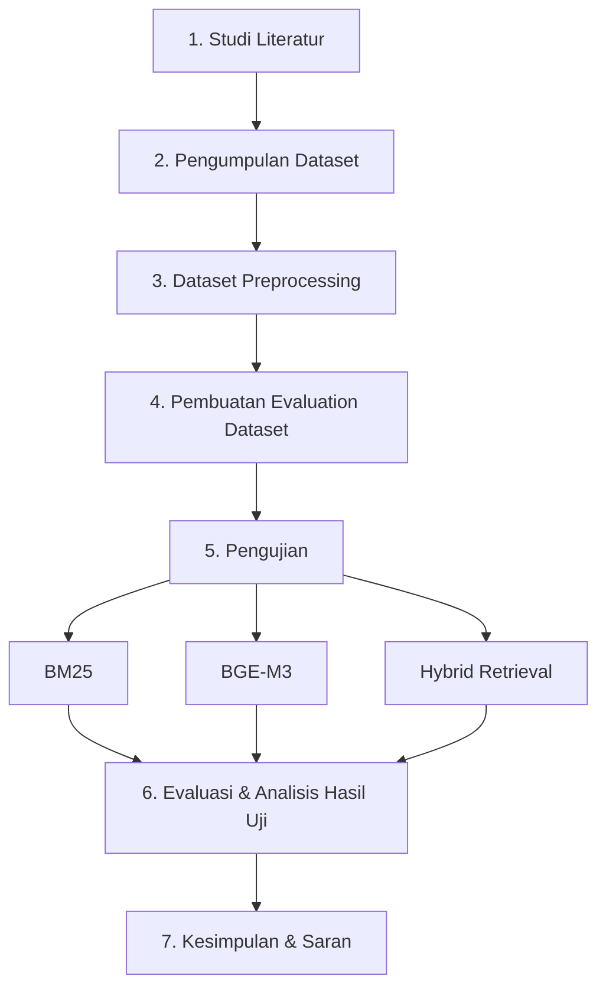

## 3.4 Tahapan Penelitian

Penelitian ini dilaksanakan melalui serangkaian tahapan sistematis untuk membandingkan performa *keyword-based retrieval*, *dense retrieval*, dan *hybrid retrieval*. Alur tahapan penelitian secara menyeluruh disajikan pada diagram alir (*flowchart*) berikut:

Secara garis besar, tahapan penelitian diawali dengan studi literatur untuk memperoleh landasan teori terkait algoritma dan teknologi *information retrieval*. Tahap kedua adalah pengumpulan dataset leksikon dari repositori Brawijaya Corpora Project. Data mentah tersebut selanjutnya diproses pada tahap *dataset preprocessing* melalui pembentukan teks dokumen, pembuatan indeks BM25, serta proses *document embedding* menggunakan BGE-M3. Tahap berikutnya adalah pembuatan dataset evaluasi yang mencakup penyusunan kueri uji beserta *ground truth* relevansi yang dipisahkan menjadi *validation set* dan *test set*. Pada tahap pengujian, dilakukan evaluasi pencarian terhadap metode BM25, BGE-M3, dan *hybrid retrieval*, termasuk optimasi parameter bobot $\alpha$ pada *validation set*. Hasil pengujian kemudian dievaluasi dan dianalisis menggunakan metrik *retrieval effectiveness* dan *computational cost*. Rangkaian penelitian diakhiri dengan penarikan kesimpulan dan pemberian saran.

Penjelasan ringkas untuk masing-masing tahapan diuraikan pada subbab-subbab berikut.

### 3.4.1 Studi Literatur

Studi literatur dilakukan dengan mempelajari teori, konsep dasar, dan penelitian terdahulu yang relevan dengan bidang *information retrieval*. Kajian difokuskan pada:
1. Pendekatan *keyword-based retrieval* menggunakan algoritma BM25 (*Best Matching 25*) serta pemahaman keterbatasan leksikal berupa *vocabulary mismatch*;
2. Pendekatan *dense semantic retrieval* berbasis representasi vektor kontinu, arsitektur model BAAI/bge-m3, dan perhitungan jarak kemiripan kosinus (*cosine similarity*);
3. Pendekatan *hybrid retrieval* yang menggabungkan skor leksikal dan semantik menggunakan fusi skor terbobot (*weighted score fusion*) serta fungsi normalisasi Min-Max;
4. Kerangka evaluasi baku sistem temu balik informasi untuk menilai kualitas hasil penelusuran (*retrieval effectiveness*) dan efisiensi beban komputasi (*computational cost*).

### 3.4.2 Pengumpulan Dataset

Dataset penelitian diperoleh dari data tekstual leksikon budaya pada repositori Brawijaya Corpora Project. Setiap entri leksikon diperlakukan sebagai satu dokumen yang dapat ditelusuri oleh sistem pencarian. Atribut-atribut tekstual yang dihimpun meliputi istilah (*term*), definisi (*definition*), contoh penggunaan dalam kalimat (*example*), serta konteks budaya atau etimologi (*cultural context / etymology*). Setiap dokumen diberi identitas unik (*unique identifier*) agar hasil penelusuran dari BM25, BGE-M3, maupun *hybrid retrieval* dapat dipetakan secara akurat terhadap leksikon yang bersangkutan serta digunakan dalam penyusunan *ground truth* evaluasi.

### 3.4.3 Dataset Preprocessing

Tahap *dataset preprocessing* bertujuan untuk mentransformasikan data mentah leksikon menjadi format representasi yang siap diproses oleh algoritma BM25 dan model BGE-M3. Tahapan ini terdiri dari tiga langkah utama:
1. **Pembentukan Dokumen Teks**: Menggabungkan atribut-atribut tekstual relevan (*term*, definisi, contoh kalimat, dan konteks budaya) menjadi satu kesatuan dokumen teks terstruktur untuk setiap entri leksikon. Atribut yang kosong tidak diikutsertakan agar dokumen tetap padat informasi.
2. **Pembuatan Indeks BM25**: Melakukan tokenisasi pada teks dokumen hasil pra-pemrosesan dan membangun struktur *inverted index* BM25 guna memfasilitasi penelusuran berbasis kecocokan kata kunci (*sparse retrieval*).
3. **Document Embedding**: Mengonversi setiap representasi dokumen teks menjadi representasi vektor padat (*dense vector*) 1024 dimensi secara *offline* menggunakan model BGE-M3, yang kemudian disimpan secara persisten ke dalam *vector database* untuk mendukung proses *similarity search*.

### 3.4.4 Pembuatan Dataset Evaluasi (*Evaluation Dataset*)

Dataset evaluasi disusun untuk menguji dan membandingkan performa temu balik ketiga metode secara objektif. Dataset ini terdiri dari kumpulan kueri uji (*test queries*) dan daftar acuan dokumen relevan (*ground truth*). Kueri uji dirancang dengan mencakup tiga skenario pencarian: kueri leksikal eksak, kueri parafrasa atau deskriptif dalam bahasa Indonesia (*vocabulary mismatch*), dan kueri konseptual berbahasa Inggris (*cross-lingual*). Dataset evaluasi dibagi secara terpisah menjadi dua bagian:
1. ***Validation Set***: Digunakan khusus untuk mengevaluasi variasi kandidat bobot parameter $\alpha$ (rentang $0$ hingga $1$) guna menentukan nilai bobot fusi optimal antara BM25 dan BGE-M3.
2. ***Test Set***: Digunakan untuk evaluasi performa akhir komparatif ketiga metode (BM25, BGE-M3, dan *hybrid retrieval* dengan parameter $\alpha$ optimal). Pemisahan ini menjamin objektivitas pengujian sehingga nilai parameter tidak dipilih berdasarkan data evaluasi akhir.

### 3.4.5 Pengujian Sistem

Tahap pengujian dilakukan untuk mengukur performa masing-masing metode penelusuran berdasarkan skenario yang telah dirancang:
1. **Pengujian BM25**: Memproses kueri uji pada indeks BM25 untuk menghasilkan skor relevansi leksikal dan urutan peringkat dokumen.
2. **Pengujian BGE-M3**: Mengonversi kueri uji menjadi *dense vector*, melakukan kalkulasi *cosine similarity* terhadap *document embedding* pada *vector store*, dan menghasilkan peringkat dokumen berdasarkan kemiripan semantik.
3. **Pencarian Parameter Bobot $\alpha$ Optimal**: Menggabungkan skor ternormalisasi Min-Max dari BM25 dan BGE-M3 pada *validation set* untuk menemukan nilai $\alpha$ terbaik berdasarkan metrik evaluasi.
4. **Pengujian Hybrid Retrieval**: Menjalankan penelusuran *hybrid* pada *test set* menggunakan nilai bobot $\alpha$ optimal hasil validasi.
5. **Pengukuran Beban Komputasi**: Mencatat durasi waktu pemrosesan kueri (*query latency*), waktu pembangunan indeks (*indexing time*), serta penggunaan memori (RAM/VRAM) dan ruang penyimpanan (*disk footprint*).

### 3.4.6 Evaluasi dan Analisis Hasil Uji

Hasil keluaran pengujian dianalisis secara kuantitatif dan komparatif melalui dua aspek evaluasi:
1. **Evaluasi Efektivitas (*Retrieval Effectiveness*)**: Menghitung skor performa penelusuran terhadap *ground truth* menggunakan metrik Precision@K, Recall@K, Mean Reciprocal Rank (MRR), dan Normalized Discounted Cumulative Gain (NDCG@K).
2. **Evaluasi Efisiensi Komputasi (*Computational Cost*)**: Menganalisis latensi respons sistem, konsumsi memori, dan efisiensi penyimpanan dari masing-masing pendekatan.
3. **Analisis Komparatif dan Identifikasi Kasus**: Membandingkan keunggulan dan kelemahan antarmetode dalam menangani fenomena *vocabulary mismatch*, efektivitas fusi skor pada *hybrid retrieval*, melakukan analisis kesalahan (*error analysis*) terhadap kueri yang gagal, serta menganalisis *trade-off* antara akurasi temu balik dan biaya komputasi yang dibutuhkan.

### 3.4.7 Penarikan Kesimpulan dan Saran

Tahap akhir penelitian adalah penarikan kesimpulan berdasarkan temuan empiris yang diperoleh dari proses evaluasi dan analisis. Kesimpulan dirumuskan secara tegas dan berbasis data kuantitatif untuk menjawab ketiga rumusan masalah penelitian, yaitu perbandingan efektivitas temu balik, perbandingan beban komputasi, serta penentuan pendekatan *information retrieval* terbaik yang direkomendasikan untuk sistem Brawijaya Corpora. Selain itu, saran-saran teknis dirumuskan guna memberikan arahan bagi penelitian lanjutan dan pertimbangan pengembangan arsitektur repositori digital Brawijaya Corpora di masa mendatang.
