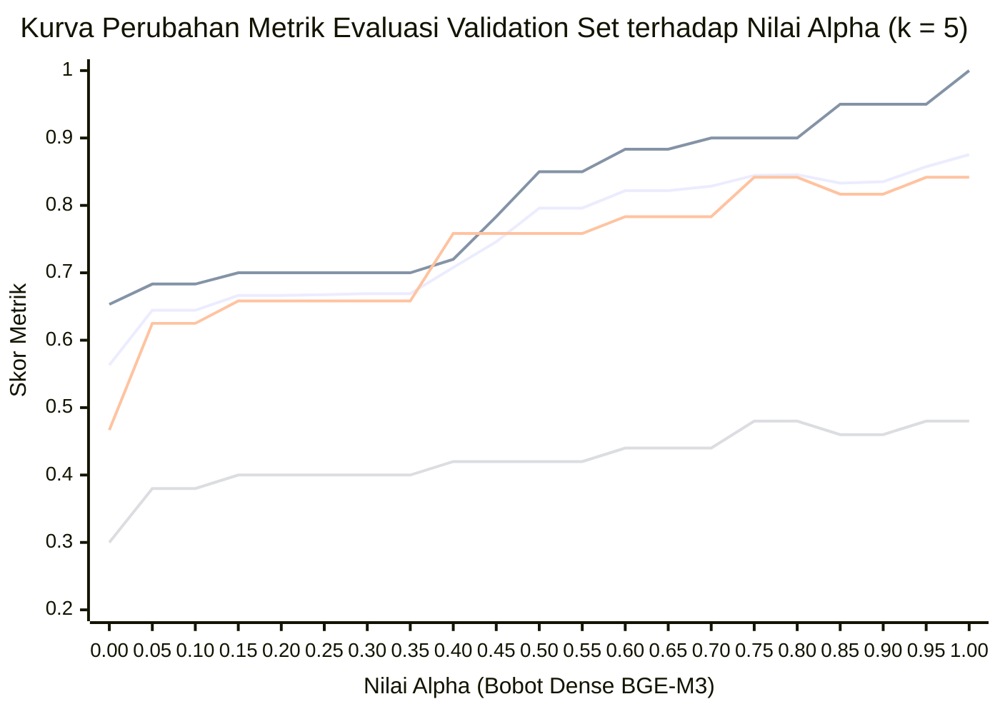

## 4.1 Hasil Penentuan Parameter $\alpha$ Optimal

Penentuan bobot parameter fusi $\alpha$ optimal pada metode *hybrid retrieval* dilaksanakan menggunakan *validation set* yang terdiri atas 10 kueri uji (5 kueri *conceptual* dan 5 kueri *exact term*, dengan total 30 pasangan penilaian relevansi) pada kedalaman peringkat $k = 5$. Pencarian kisi (*grid search*) dijalankan pada rentang $\alpha \in [0{,}00, 1{,}00]$ dengan interval (*step*) $0{,}05$, sehingga menghasilkan 21 titik konfigurasi kombinasi bobot antara jalur *dense retrieval* (BGE-M3, berbobot $w_{\text{dense}} = \alpha$) dan jalur *sparse retrieval* (Okapi BM25, berbobot $w_{\text{sparse}} = 1 - \alpha$).

### 4.1.1 Data Evaluasi Variasi Nilai Parameter $\alpha$

Hasil pengujian seluruh kandidat nilai parameter $\alpha$ pada *validation set* disajikan pada Tabel 4.1. Pengukuran mencakup empat metrik evaluasi *information retrieval* secara keseluruhan (*overall*), yaitu Precision@5, Recall@5, Mean Reciprocal Rank (MRR), dan Normalized Discounted Cumulative Gain (NDCG@5).

Tabel 4.1 Perbandingan Skor Evaluasi *Validation Set* terhadap Variasi Parameter $\alpha$ ($k = 5$)

| Nilai $\alpha$ | Bobot BGE-M3 ($\alpha$) | Bobot BM25 ($1 - \alpha$) | Precision@5 | Recall@5 | MRR | NDCG@5 |
| :---: | :---: | :---: | :---: | :---: | :---: | :---: |
| 0,00 | 0,00 | 1,00 | 0,3000 | 0,4667 | 0,6533 | 0,5632 |
| 0,05 | 0,05 | 0,95 | 0,3800 | 0,6250 | 0,6833 | 0,6444 |
| 0,10 | 0,10 | 0,90 | 0,3800 | 0,6250 | 0,6833 | 0,6444 |
| 0,15 | 0,15 | 0,85 | 0,4000 | 0,6583 | 0,7000 | 0,6664 |
| 0,20 | 0,20 | 0,80 | 0,4000 | 0,6583 | 0,7000 | 0,6664 |
| 0,25 | 0,25 | 0,75 | 0,4000 | 0,6583 | 0,7000 | 0,6675 |
| 0,30 | 0,30 | 0,70 | 0,4000 | 0,6583 | 0,7000 | 0,6692 |
| 0,35 | 0,35 | 0,65 | 0,4000 | 0,6583 | 0,7000 | 0,6692 |
| 0,40 | 0,40 | 0,60 | 0,4200 | 0,7583 | 0,7200 | 0,7079 |
| 0,45 | 0,45 | 0,55 | 0,4200 | 0,7583 | 0,7833 | 0,7460 |
| 0,50 | 0,50 | 0,50 | 0,4200 | 0,7583 | 0,8500 | 0,7960 |
| 0,55 | 0,55 | 0,45 | 0,4200 | 0,7583 | 0,8500 | 0,7960 |
| 0,60 | 0,60 | 0,40 | 0,4400 | 0,7833 | 0,8833 | 0,8218 |
| 0,65 | 0,65 | 0,35 | 0,4400 | 0,7833 | 0,8833 | 0,8218 |
| 0,70 | 0,70 | 0,30 | 0,4400 | 0,7833 | 0,9000 | 0,8285 |
| 0,75 | 0,75 | 0,25 | **0,4800** | **0,8417** | 0,9000 | 0,8445 |
| 0,80 | 0,80 | 0,20 | **0,4800** | **0,8417** | 0,9000 | 0,8456 |
| 0,85 | 0,85 | 0,15 | 0,4600 | 0,8167 | 0,9500 | 0,8330 |
| 0,90 | 0,90 | 0,10 | 0,4600 | 0,8167 | 0,9500 | 0,8352 |
| 0,95 | 0,95 | 0,05 | **0,4800** | **0,8417** | 0,9500 | 0,8574 |
| **1,00** | **1,00** | **0,00** | **0,4800** | **0,8417** | **1,0000** | **0,8754** |

Berdasarkan data pada Tabel 4.1, rentang perolehan nilai pada masing-masing metrik evaluasi di seluruh variasi parameter $\alpha \in [0{,}00, 1{,}00]$ adalah sebagai berikut:

1. **Precision@5** berada pada rentang **0,3000** hingga **0,4800**. Nilai terendah tercatat pada $\alpha = 0{,}00$ (*sparse* murni), sedangkan nilai tertinggi sebesar 0,4800 dicapai pada $\alpha = 0{,}75$; $0{,}80$; $0{,}95$; dan $1{,}00$.
2. **Recall@5** berada pada rentang **0,4667** hingga **0,8417**. Nilai terendah tercatat pada $\alpha = 0{,}00$, sedangkan nilai tertinggi sebesar 0,8417 diperoleh pada $\alpha = 0{,}75$; $0{,}80$; $0{,}95$; dan $1{,}00$.
3. **MRR** berada pada rentang **0,6533** hingga **1,0000**. Skor MRR meningkat bertahap dari titik terendah pada $\alpha = 0{,}00$ hingga mencapai nilai sempurna 1,0000 pada $\alpha = 1{,}00$.
4. **NDCG@5** berada pada rentang **0,5632** hingga **0,8754**. Nilai terendah diperoleh pada $\alpha = 0{,}00$, sedangkan nilai tertinggi diperoleh pada $\alpha = 1{,}00$.

Jika ditinjau per kategori kueri pada *validation set*, metrik segmen *exact term* mencatatkan nilai MRR konstan sebesar **1,0000** pada seluruh 21 nilai $\alpha$, dengan NDCG@5 berada pada rentang **0,8891** ($\alpha = 0{,}00$) hingga **0,9779** ($\alpha = 0{,}75$ dan $0{,}80$), serta bernilai **0,9631** pada $\alpha = 1{,}00$. Sementara itu, metrik segmen *conceptual* bergerak naik dari NDCG@5 **0,2373** dan MRR **0,3067** pada $\alpha = 0{,}00$ hingga mencapai puncak NDCG@5 **0,7877** dan MRR **1,0000** pada $\alpha = 1{,}00$.

### 4.1.2 Karakteristik Perubahan Skor Metrik terhadap Nilai $\alpha$

Pola perubahan keempat metrik evaluasi terhadap pergeseran kandidat nilai $\alpha$ dari $0{,}00$ ke $1{,}00$ divisualisasikan pada Gambar 4.1.

Gambar 4.1 Kurva Perubahan Metrik Evaluasi (dari atas ke bawah pada $\alpha = 1{,}00$: MRR, NDCG@5, Recall@5, dan Precision@5) terhadap Kandidat Nilai $\alpha$

Merujuk pada kurva di Gambar 4.1 dan data pada Tabel 4.1, pergeseran bobot $\alpha$ menunjukkan kecenderungan peningkatan skor secara bertahap seiring bertambahnya porsi bobot *dense* BGE-M3, dengan sejumlah titik mendatar (*plateau*) pada beberapa interval kecil (seperti $\alpha = 0{,}05\text{--}0{,}10$; $0{,}15\text{--}0{,}20$; $0{,}30\text{--}0{,}35$; $0{,}50\text{--}0{,}55$; serta $0{,}60\text{--}0{,}65$). Lonjakan awal terjadi pada transisi $\alpha = 0{,}00$ ke $\alpha = 0{,}05$, di mana NDCG@5 naik dari 0,5632 menjadi 0,6444 dan Recall@5 naik dari 0,4667 menjadi 0,6250.

Kenaikan berlanjut hingga mencapai puncak lokal pada $\alpha = 0{,}80$ (NDCG@5 sebesar 0,8456, MRR sebesar 0,9000, Precision@5 sebesar 0,4800, dan Recall@5 sebesar 0,8417), lalu mengalami sedikit penurunan sementara pada $\alpha = 0{,}85$ dan $0{,}90$ untuk metrik NDCG@5 (0,8330 dan 0,8352), Precision@5 (0,4600), dan Recall@5 (0,8167), sementara MRR justru meningkat ke angka 0,9500. Setelah titik tersebut, keempat metrik kembali meningkat hingga mencapai performa tertinggi (*optimal score*) secara keseluruhan pada **$\alpha = 1{,}00$** ($w_{\text{dense}} = 1{,}00$, $w_{\text{sparse}} = 0{,}00$) dengan perolehan **NDCG@5 = 0,8754**, **MRR = 1,0000**, **Precision@5 = 0,4800**, dan **Recall@5 = 0,8417**. Berdasarkan kriteria seleksi metrik utama NDCG@5 tertinggi pada *validation set*, nilai **$\alpha = 1{,}00$** ditetapkan sebagai parameter optimal untuk pengujian *hybrid retrieval* pada *test set*, disertai konfigurasi fusi berimbang **$\alpha = 0{,}60$** (NDCG@5 = 0,8218 dan MRR = 0,8833 pada *validation set*) sebagai pembanding perilaku kombinasi *sparse-dense* pada Bab 4.2.