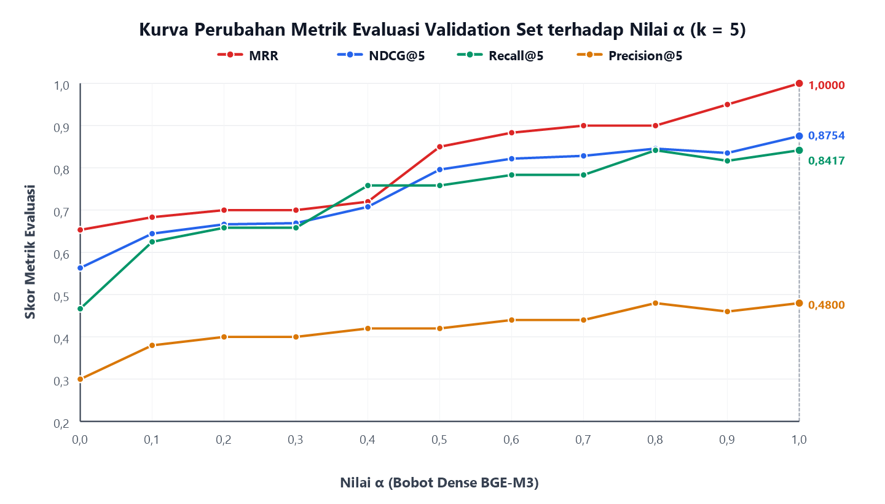

## 4.1 Hasil Penentuan Parameter $\alpha$ Optimal

Penentuan bobot parameter fusi $\alpha$ optimal pada *hybrid retrieval* dilakukan pada *validation set* (10 kueri: 5 *conceptual* dan 5 *exact term*, total 30 pasangan relevansi) pada $k = 5$ untuk variasi $\alpha \in [0{,}0, 1{,}0]$ dengan interval $0{,}1$ ($w_{\text{dense}} = \alpha$ untuk BGE-M3 dan $w_{\text{sparse}} = 1 - \alpha$ untuk BM25). Hasil evaluasi dari 11 konfigurasi nilai $\alpha$ disajikan pada Tabel 4.1 dan divisualisasikan pada Gambar 4.1.

Tabel 4.1 Perbandingan Skor Evaluasi *Validation Set* terhadap Variasi Parameter $\alpha$ ($k = 5$)

| Nilai $\alpha$ | Bobot BGE-M3 ($\alpha$) | Bobot BM25 ($1 - \alpha$) | Precision@5 | Recall@5 | MRR | NDCG@5 |
| :---: | :---: | :---: | :---: | :---: | :---: | :---: |
| 0,0 | 0,0 | 1,0 | 0,3000 | 0,4667 | 0,6533 | 0,5632 |
| 0,1 | 0,1 | 0,9 | 0,3800 | 0,6250 | 0,6833 | 0,6444 |
| 0,2 | 0,2 | 0,8 | 0,4000 | 0,6583 | 0,7000 | 0,6664 |
| 0,3 | 0,3 | 0,7 | 0,4000 | 0,6583 | 0,7000 | 0,6692 |
| 0,4 | 0,4 | 0,6 | 0,4200 | 0,7583 | 0,7200 | 0,7079 |
| 0,5 | 0,5 | 0,5 | 0,4200 | 0,7583 | 0,8500 | 0,7960 |
| 0,6 | 0,6 | 0,4 | 0,4400 | 0,7833 | 0,8833 | 0,8218 |
| 0,7 | 0,7 | 0,3 | 0,4400 | 0,7833 | 0,9000 | 0,8285 |
| 0,8 | 0,8 | 0,2 | **0,4800** | **0,8417** | 0,9000 | 0,8456 |
| 0,9 | 0,9 | 0,1 | 0,4600 | 0,8167 | 0,9500 | 0,8352 |
| **1,0** | **1,0** | **0,0** | **0,4800** | **0,8417** | **1,0000** | **0,8754** |

Gambar 4.1 Kurva Perubahan Metrik Evaluasi (Precision@5, Recall@5, MRR, dan NDCG@5) terhadap Kandidat Nilai $\alpha$

Berdasarkan Tabel 4.1 dan Gambar 4.1, rentang perolehan skor pada *validation set* adalah Precision@5 **0,3000–0,4800**, Recall@5 **0,4667–0,8417**, MRR **0,6533–1,0000**, dan NDCG@5 **0,5632–0,8754**. Skor keempat metrik meningkat secara bertahap seiring bertambahnya nilai $\alpha$ (dengan sedikit penurunan sementara pada $\alpha = 0{,}9$) hingga mencapai nilai optimal tertinggi pada **$\alpha = 1{,}0$** (**NDCG@5 = 0,8754**; **MRR = 1,0000**; **Precision@5 = 0,4800**; **Recall@5 = 0,8417**). Parameter **$\alpha = 1{,}0$** tersebut ditetapkan sebagai konfigurasi optimal untuk pengujian *test set*, disertai konfigurasi pembanding **$\alpha = 0{,}6$** (NDCG@5 = 0,8218; MRR = 0,8833).
