## 4.3 Hasil Pengukuran Beban Komputasi

Pengukuran beban komputasi (*computational cost*) dilaksanakan bersamaan dengan pengujian 40 kueri *test set* pada lingkungan uji terisolasi (Tabel 3.2) menggunakan modul `ResourceMonitor` (berbasis `psutil`, `nvidia-smi`, dan kueri ukuran penyimpanan PostgreSQL). Pengukuran mencakup durasi respons sistem (*query latency*), kebutuhan ruang penyimpanan (*disk footprint*), serta penggunaan memori (RAM/VRAM) dan utilisasi CPU/GPU. Sistem *baseline* eksternal (*BCP Lexical Search*) tidak diinstrumentasi dalam lingkungan lokal sehingga metrik beban komputasinya tercatat sebagai tidak tersedia (*N/A*).

### 4.3.1 Durasi Respons Sistem (*Query Latency*)

Hasil pengukuran latensi pemrosesan kueri untuk seluruh metode lokal pada *test set* ($40$ kueri, setelah *warmup query*) disajikan pada Tabel 4.4.

Tabel 4.4 Pengukuran Latensi Pemrosesan Kueri Antarmetode (dalam milidetik/ms)

| Metode Penelusuran | Rata-rata (*Mean*) | Median (P50) | Persentil 95 (P95) | Min | Maks | QPS |
| :--- | :---: | :---: | :---: | :---: | :---: | :---: |
| *BCP Lexical Search* (*Baseline*) | *N/A* | *N/A* | *N/A* | *N/A* | *N/A* | *N/A* |
| BM25 (*Sparse Retrieval*) | **0,12** | **0,03** | **0,54** | **0,01** | **0,59** | **8.573,20** |
| BGE-M3 (*Dense Retrieval*) | 180,48 | 183,29 | 211,43 | 125,85 | 298,01 | 5,54 |
| *Hybrid Retrieval* ($\alpha = 1{,}00$) | 192,53 | 198,10 | 237,82 | 135,72 | 268,43 | 5,19 |
| *Hybrid Retrieval* ($\alpha = 0{,}60$) | 196,40 | 197,63 | 240,20 | 146,22 | 271,59 | 5,09 |

Visualisasi perbandingan distribusi waktu respons kueri (Mean, Median/P50, dan P95) antarmetode lokal ditunjukkan pada Gambar 4.2.

```mermaid
xychart-beta
    title "Distribusi Waktu Respons Kueri per Metode (Mean, P50, P95 dalam ms)"
    x-axis "Metode Penelusuran" ["BM25", "BGE-M3", "Hybrid (a=1.00)", "Hybrid (a=0.60)"]
    y-axis "Latensi (ms)" 0 --> 260
    bar [0.12, 180.48, 192.53, 196.40]
    bar [0.03, 183.29, 198.10, 197.63]
    bar [0.54, 211.43, 237.82, 240.20]
```

Gambar 4.2 Diagram Batang Distribusi Waktu Respons Kueri per Metode (urutan batang per metode dari kiri ke kanan: Rata-rata/*Mean*, Median/P50, dan P95)

Berdasarkan Tabel 4.4 dan Gambar 4.2, **BM25** mencatat waktu eksekusi tercepat dengan rata-rata **0,12 ms** (median **0,03 ms**, P95 **0,54 ms**, dan *throughput* **8.573,20 QPS**). **BGE-M3** memerlukan rata-rata **180,48 ms** per kueri (median **183,29 ms**, P95 **211,43 ms**, *throughput* **5,54 QPS**). Sementara itu, ***Hybrid Retrieval*** mencatat rata-rata **192,53 ms** (P95 **237,82 ms**, **5,19 QPS**) pada $\alpha = 1{,}00$ dan **196,40 ms** (P95 **240,20 ms**, **5,09 QPS**) pada $\alpha = 0{,}60$.

### 4.3.2 Durasi Pembangunan Indeks (*Indexing Time*)

Perbandingan durasi pembangunan struktur indeks dokumen leksikon (169 entri) direncanakan pada Tabel 4.5.

Tabel 4.5 Perbandingan Waktu Pembangunan Struktur Indeks Dokumen Leksikon

| Metode Penelusuran | Komponen Indeks | Waktu Pembangunan Indeks |
| :--- | :--- | :---: |
| BM25 (*Sparse Retrieval*) | Konstruksi *in-memory inverted index* & simpan `bm25_index.pkl` | *Belum tercatat pada log `exp_1`* |
| BGE-M3 (*Dense Retrieval*) | Inferensi vektor 1024-dimensi & pembuatan indeks HNSW `pgvector` | *Belum tercatat pada log `exp_1`* |

> **Catatan Ketersediaan Data:** Pada rangkaian eksekusi `exp_1` (`run_evaluation.py`), skrip evaluasi memuat indeks yang telah dibangun sebelumnya sehingga durasi pembangunan indeks (`reindex` BM25 maupun `generate_embeddings` BGE-M3) tidak tersimpan ke dalam berkas laporan `exp_1`. Pengukuran khusus tahap pembangunan indeks diperlukan apabila data waktu pengindeksan awal hendak dilaporkan secara kuantitatif.

### 4.3.3 Kebutuhan Memori dan Ruang Penyimpanan (*Memory & Storage Footprint*)

Hasil audit konsumsi ruang penyimpanan di media penyimpanan (*disk footprint*), penggunaan memori RAM proses sebelum/selama pemrosesan kueri, memori GPU (VRAM), serta utilisasi CPU disajikan pada Tabel 4.6.

Tabel 4.6 Konsumsi Ruang Penyimpanan Indeks (*Disk Footprint*) dan Memori (*RAM/VRAM Usage*)

| Metode Penelusuran | Total Ruang Penyimpanan (MB) | Memori RAM Awal/*Idle* (MB) | Memori RAM Puncak Saat Kueri (MB) | VRAM GPU Puncak (MiB) | CPU Proses Rata-rata (Puncak) |
| :--- | :---: | :---: | :---: | :---: | :---: |
| *BCP Lexical Search* (*Baseline*) | *N/A* (DB Eksisting) | *N/A* | *N/A* | *N/A* | *N/A* |
| BM25 (*Sparse Retrieval*) | **0,33** | 1.932,97 | 1.932,99 (+0,02) | 1.376,00 | 0,00% (0,00%) |
| BGE-M3 (*Dense Retrieval*) | 4.353,61 | 1.933,03 | 1.937,57 (+4,54) | 1.376,00 | 549,28% (662,50%) |
| *Hybrid Retrieval* ($\alpha = 1{,}00$) | 4.353,94 | 1.937,57 | 1.938,02 (+0,46) | 1.376,00 | 560,57% (675,00%) |
| *Hybrid Retrieval* ($\alpha = 0{,}60$) | 4.353,94 | 1.937,59 | 1.937,90 (+0,30) | 1.376,00 | 556,79% (675,00%) |

Berdasarkan data pada Tabel 4.6, ringkasan konsumsi sumber daya komputasi masing-masing metode adalah sebagai berikut:

1. **Ruang Penyimpanan (*Disk Footprint*):** **BM25** hanya membutuhkan **0,33 MB** (**338,90 KB**) untuk berkas *inverted index* (`bm25_index.pkl`). **BGE-M3** membutuhkan total **4.353,61 MB**, yang terdiri atas **4.352,95 MB** bobot model `BAAI/bge-m3` dan **676,66 KB** kolom vektor `pgvector` di basis data. ***Hybrid Retrieval*** ($\alpha = 1{,}00$ maupun $\alpha = 0{,}60$) menggabungkan seluruh komponen tersebut dengan total **4.353,94 MB**.
2. **Memori (RAM & VRAM) dan Utilisasi CPU:** Selama pengujian berurutan dalam satu proses, RAM *baseline* berada di kisaran **1.932,97–1.937,59 MB** dengan tambahan kenaikan (*delta*) saat eksekusi kueri sebesar **+0,02 MB** pada BM25, **+4,54 MB** pada BGE-M3, serta **+0,46 MB** dan **+0,30 MB** pada *Hybrid Retrieval*. VRAM GPU puncak tercatat tetap sebesar **1.376,00 MiB** (*delta* 0,00 MiB pada seluruh metode), sementara utilisasi CPU proses rata-rata tercatat **0,00%** pada BM25 dan **549,28%–560,57%** (puncak **662,50%–675,00%**, *system CPU* rata-rata **61,39%–63,41%**) pada metode berbasis BGE-M3.
